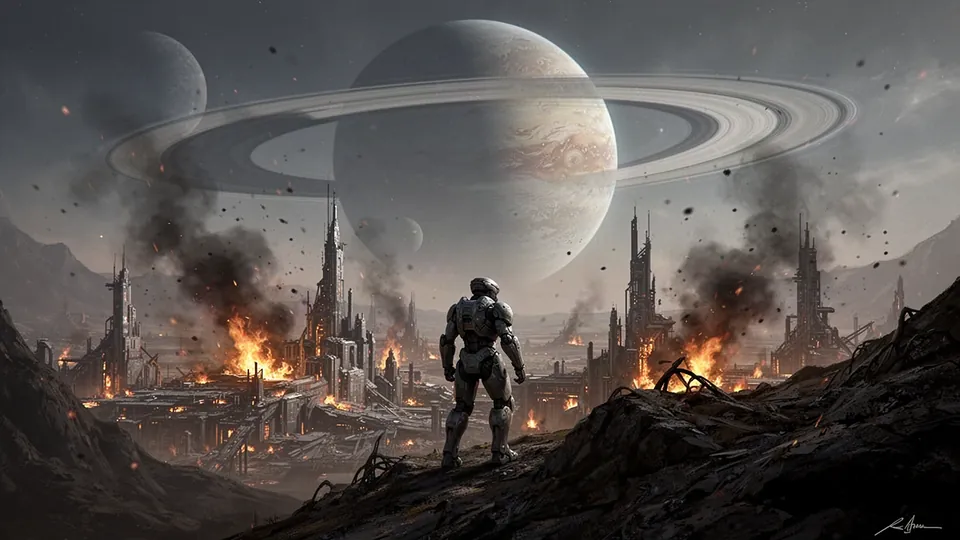

<p align="center">
  
</p>

<h1 align="center">ASHFALL: Lumen Tide</h1>

<p align="center">
  <strong>Överlev 30 minuter i en gruvkoloni som tagits över av ljuset.</strong><br>
  Ett mörkt överlevnadsspel för AYN Thor och andra Android-enheter.
</p>

<p align="center">
  <a href="https://github.com/felixarvid2/thor-survivors/releases/latest"></a>
  
  
</p>

Du har kraschat på en övergiven gruvkoloni där **lumen**, en lysande infektion, har tagit över allt levande. Kolonister, djur och maskiner väller fram i allt större vågor. Uppdraget är enkelt att förstå och svårt att klara: håll dig vid liv i 30 minuter.

Spelet är inspirerat av *Vampire Survivors* och *Halls of Torment*. Du styr bara hur hjälten rör sig, siktar och undviker – vapnen skjuter av sig själva. Varje fiende lämnar kristaller som du använder för att gå upp i nivå och välja nya vapen, uppgraderingar och förmågor.

## Ladda ner

Hämta senaste APK:n under [Releases](https://github.com/felixarvid2/thor-survivors/releases/latest) och installera den på enheten. Du behöver tillåta installation från okända källor.

Spelet är utvecklat för **AYN Thor** med två skärmar, men fungerar också på vanliga Android-enheter med en skärm.

## Det här gör du

- **Välj bland tre hjältar** med helt olika spelstil: en tung närstridskämpe med hammare, en snabb skytt och en mystiker som förgiftar och sprider sporer.
- **Bygg en ny kombination varje runda.** Vapen kan utvecklas med rätt följeslagare, och två fullt uppgraderade vapen kan smälta samman till ett helt nytt.
- **Utforska fem banor** med egna regler, fiender och faror – från askslätten Cinder Flats till det kraschade fraktskeppet Meridian Wreck.
- **Möt bossar** och till slut det som väntar längst ner i mörkret.
- **Hitta hemligheter** som vapenlådor, utrustningsskåp, övergivna utposter, reläterminaler och ett förseglat valv.
- **Bygg långsiktigt** med guld, bestående uppgraderingar, fem ascension-nivåer per bana, curse-reglage, dagliga utmaningar och achievements.

## Två skärmar

Den övre skärmen visar spelvärlden. Den nedre har hälsa, vapen, utrustning, karta och menyer – så att själva spelet får ta hela den övre skärmen.

## Kontroller

| Knapp | Gör |
|---|---|
| Vänster spak | Gå |
| Höger spak | Sikta |
| A eller B | Undvik |
| Start | Paus |

Knapparna kan bytas i **Options**, där du också ställer in skakning, skadesiffror, stor text, färgblindläge, sikthjälp och vibration.

## För utvecklare

<details>
<summary>Bygg och testa</summary>

Spelet är byggt i Java med Gradle och har ett eget verifieringsverktyg i `tools/`.

```bash
./gradlew assembleDebug
```

Teknisk dokumentation finns i [docs/TEKNIK.md](docs/TEKNIK.md) och designen i [docs/ASHFALL_DESIGN.md](docs/ASHFALL_DESIGN.md).

</details>

## Om projektet

ASHFALL: Lumen Tide är ett privat hobbyprojekt och är endast avsett för privat bruk. All grafik, musik och kod är skapad för projektet eller används under tillåtande licenser. Se [docs/TEKNIK.md](docs/TEKNIK.md) för en fullständig lista.
